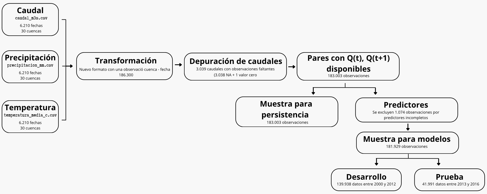

```{r}
#| label: cargar-resultados
#| include: false

objetos_guardados <- readRDS("resultados_informe.rds")

list2env(objetos_guardados, envir = environment())

rm(objetos_guardados)
```

```{=latex}
\thispagestyle{empty}
\noindent
\begin{minipage}[c]{0.17\textwidth}
  \includegraphics[width=\linewidth]{logouc.png}
\end{minipage}%
\hspace{0.6cm}%
\begin{minipage}[c]{0.7\textwidth}
  \raggedright
  \fontsize{11}{15}\selectfont
  \textsc{Pontificia Universidad Católica de Chile}\\
  \textsc{Facultad de Matemáticas}\\
  \textsc{EYP3407 -- Tópicos Aplicados en Estadística}\\
  \textsc{Profesor: Eloy Alvarado Narváez}\\
  \textsc{Ayudante: Andrés Díaz}
\end{minipage}

\begin{center}
  {\Large\bfseries Informe final\par}
  \vspace{0.1cm}
  {\large 12 de noviembre de 2026\par}
  {\normalsize Javier Encina -- Camila Moreno -- Romina Navarro -- Javiera Sotolincoñir\par}
  {\normalsize\bfseries ¿Cuánto mejora un modelo estadístico la predicción del caudal del día siguiente frente a mantener el caudal observado hoy?\par}
\end{center}
```

## Resumen ejecutivo

Escribe aquí el resumen ejecutivo del informe (máximo 250 palabras).

## Problema y datos
Una cuenca corresponde a una zona donde el agua proveniente de lluvias, deshielos o manantiales desemboca en un cuerpo de agua común como un río, lago u océano. Las cuencas desempeñan un papel crucial pues determinan tanto cantidad como disponibilidad del agua, además de ser fundamentales para la agricultura (Washington State Department of Ecology, s. f.).

En ese contexto, la predicción del caudal del día siguiente constituye una herramienta potencialmente útil para la gestión y planificación de los recursos hídricos. Sin embargo, esta tarea presenta dificultades debido a la variabilidad de las condiciones meteorológicas y a las diferencias físicas entre cuencas, que pueden provocar comportamientos hidrológicos distintos.

Para responder la pregunta de investigación se comparan distintos procedimientos estadísticos en base a registros históricos y características del caudal, además de antecedentes de precipitación y temperatura.

Los datos provienen de CAMELS-CL (Catchment Attributes and Meteorology for Large Sample Studies, Chile), la primera base de datos hidrometeorológica y de atributos a gran escala desarrollada para Chile. Esta reúne información de 516 cuencas chilenas y fue presentada por Alvarez-Garreton et al. (2018).

En particular, los datos del informe corresponden a un subconjunto de datos de CAMELS-CL proporcionado para el **Caso 01 del curso EYP3407**, cuya copia de datos fue preparada el 12 de octubre 2026. Dicho subconjunto comprende 30 cuencas ubicadas entre los 33° y 40° de latitud sur, seleccionadas según la mayor cantidad de días con caudal observado entre 2000 y 2012, utilizando el identificador de cuenca como criterio de desempate. Se dispone de cuatro archivos originales con la información de los caudales $Q$, la precipitación y temperatura registrada, además de un diccionario con atributos adicionales. Todos los datos registrados corresponden a la ventana de tiempo generada entre 01/01/2000 y 31/12/2016 (Tabla \ref{tab:archivos}).

```{r}
#| echo: false
#| results: asis
#| warning: false

# TABLA DE ARCHIVOS ORIGINALES
tabla_archivos <- data.frame(
  Archivo = c(
    "\\texttt{caudal\\_m3s.csv}",
    "\\texttt{precipitacion\\_mm.csv}",
    "\\texttt{temperatura\\_media\\_c.csv}",
    "\\texttt{atributos.csv}"
  ),
  Descripcion = c(
    "Caudal diario de las 30 cuencas, expresado en m³/s.",
    "Precipitación diaria CR2MET, expresada en mm/día.",
    "Temperatura media diaria CR2MET, expresada en °C.",
    "Atributos físicos, climáticos e hidrológicos de las cuencas."
  ),
  Observaciones = c(
    nrow(caudal),
    nrow(precipitacion),
    nrow(temperatura),
    nrow(atributos)
  )
)

# Formato de miles
tabla_archivos$Observaciones <- format(
  tabla_archivos$Observaciones,
  big.mark = ".",
  scientific = FALSE,
  trim = TRUE
)

# Generar tabla en LaTeX
latex_archivos <- knitr::kable(
  tabla_archivos,
  format = "latex",
  booktabs = FALSE,
  align = c("l", "l", "r"),
  escape = FALSE,
  linesep = ""
)

# Forzar líneas verticales en todos los bordes
lineas <- strsplit(
  as.character(latex_archivos),
  "\n",
  fixed = TRUE
)[[1]]

posicion <- grep(
  "^\\\\begin\\{tabular\\}",
  lineas
)

stopifnot(length(posicion) == 1)

lineas[posicion] <- "\\begin{tabular}{|l|l|r|}"

latex_archivos <- paste(lineas, collapse = "\n")

# Mostrar tabla con título debajo
cat(paste0(
  "\\begin{table}[H]\n",
  "\\centering\n",
  "\\small\n",
  latex_archivos,
  "\n\\caption{Archivos originales utilizados en el análisis}\n",
  "\\label{tab:archivos}\n",
  "\\end{table}\n"
))
```


La **población de estudio** corresponde a las observaciones diarias de las 30 cuencas chilenas incluídas en el subconjunto de datos entregado en la respectiva ventana de tiempo.

La **unidad de observación** se define como un par entre la cuenca y la fecha, de manera que ambas variables en conjunto identifican cada registro. Se define $Q_t$ como el caudal observado en una cuenca durante el día de origen $t$, con $t \in \{1, 2, \cdots, 6.210\}$ correspondiente a las fechas disponibles.

La **variable respuesta** corresponde al caudal del día siguiente definido como $Q_{t+1}$.

Para construir la muestra analítica (@fig-muestra) se re-estructuró inicialmente $\texttt{caudal\_m3s.csv}$ que contiene 6.210 filas y 30 columnas correspondientes a las fechas e identificadores de las cuencas (respectivamente), de tal manera que en el resultado, cada fila contenga el par (ID cuenca - fecha $t$), generando un total de 186.300 observaciones (Tabla \ref{tab:muestra}).

Posteriormente, las tres series se integraron mediante el identificador de cuenca y la fecha, obteniendo una base con la información del caudal de la cuenca $Q$, la precipitación $P$ y la temperatura media Temp , estableciendo relaciones uno a uno entre registros. Se verificó la unicidad de las claves y la conservación de las 186.300 observaciones después de cada unión, manteniendo las 30 cuencas originales, sin duplicados.

Se identifican 3.038 valores faltantes del caudal y una observación con valor cero correspondiente a la cuenca del río Toltén, en la Región de La Araucanía, el 1 de enero de 2003. La cuenca del río Toltén presenta un clima templado cálido lluvioso con influencia mediterránea en sus sectores medio y bajo, y un clima templado frío lluvioso con influencia mediterránea en su sector precordillerano (Dirección General de Aguas [DGA], 2004, p. 5). Considerando estas características, el registro de caudal cero fue identificado como anómalo. Dado que el análisis contempla transformaciones logarítmicas, se decidió tratar dicho registro como un valor faltante, sin confirmar un error de medición. Con ello, se obtuvo un total de 3.039 registros de caudal faltantes.

A continuación se construyó la variable respuesta $Q_{t+1}$ desplazando la serie para que cada fila $Q_t$ tenga su respectivo $Q_{t+1}$ verificando que no haya error en las asociaciones. Se conservaron únicamente los pares cuenca–fecha con valores observados tanto de $Q_t$ como de $Q_{t+1}$, por lo que se disponen de 183.003 observaciones.

Adicionalmente, se construyeron variables predictoras a partir de la información disponible hasta el día de origen $t$: algunas asociadas al día anterior, como ($Q_{t-1}$, $P_{t-1}$), otras que dan cuenta de la precipitación acumulada en las últimas 3, 7 y 30 fechas y la temperatura media de las últimas 7 fechas.

La disponibilidad de estos predictores redujo la muestra a 181.899 registros completos. Finalmente, se estableció una separación temporal entre el período de desarrollo, correspondiente a 2000–2012, y el período reservado para prueba final, correspondiente a 2013–2016. Las observaciones se asignaron considerando la fecha de la respuesta, de modo que la información del período de prueba no se utilizara para el desarrollo de los modelos. La muestra quedó conformada por 139.938 registros de desarrollo y 41.961 de prueba.

A la hora de construir la base de datos para la elaboración de modelos, es importante considerar que las variables utilizadas como predictores deben estar disponibles en la fecha $t$ para poder predecir $t+1$. En caso contrario, se incurre en fuga de información, pues el modelo se construye utilizando información futura.
Por ello, es importante mencionar que las variables: $Q_t$, $Q_{t-1}$, $P_t$, $P_{t-1}$, la precipitación acumulada en las últimas 3, 7 y 30 fechas, además de la temperatura promedio de las últimas 7 fechas son conocidos en la fecha que se realiza la predicción $t$, por lo que su uso no implica fuga de información. Por su parte, el archivo $\texttt{atributos.csv}$ contiene grupos de variables que, de ser usadas como predictoras, provocarían una fuga de información, como por ejemplo, medidas de resumen (promedios, medianas, etc) calculadas en base a la totalidad de los datos (Tabla \ref{tab:variables}).

{#fig-muestra width=100% fig-align="center"}

```{r}
#| label: tabla-construccion-muestra
#| echo: false
#| results: asis
#| warning: false

# Registros con caudal de hoy y mañana disponibles
pares_validos <- !is.na(datos$Q) & !is.na(datos$Q_manana)

# Predictores utilizados en los modelos
predictores <- c(
  "cambio_hoy", "log_Q", "P", "P_ayer",
  "lluvia_3d", "lluvia_7d", "lluvia_30d",
  "Temp", "temp_7d", "mes"
)

# Registros con respuesta y predictores completos
registros_completos <- pares_validos &
  !is.na(datos$Q_ayer) &
  complete.cases(datos[, predictores])

# Separación temporal
desarrollo_ok <- registros_completos &
  datos$fecha <= as.Date("2012-12-30")

prueba_ok <- registros_completos &
  datos$fecha >= as.Date("2013-01-01")

# Recuentos
n_inicial <- nrow(caudal) * (ncol(caudal) - 1)
n_na <- sum(is.na(caudal[, -1]))
n_ceros <- sum(as.matrix(caudal[, -1]) == 0, na.rm = TRUE)
n_faltantes <- sum(is.na(datos$Q))
n_pares <- sum(pares_validos)
n_desarrollo <- sum(desarrollo_ok)
n_prueba <- sum(prueba_ok)
n_completos <- n_desarrollo + n_prueba

# Construir tabla
tabla_muestra <- data.frame(
  Etapa = c(
    "Registros iniciales (30 cuencas x 6.210 días)",
    "Cantidad de caudales NA",
    "Cantidad de caudales con $Q_t = 0$",
    "Total de caudales faltantes tras limpieza",
    "Observaciones con $Q_t$ y $Q_{t+1}$ disponibles",
    "Cantidad de obs. excluidas por predictores incompletos",
    "Observaciones con respuesta y predictores completos",
    "Observaciones entrenamiento",
    "Observaciones prueba"
  ),
  Observaciones = c(
    n_inicial,
    n_na,
    n_ceros,
    n_faltantes,
    n_pares,
    n_pares - n_completos,
    n_completos,
    n_desarrollo,
    n_prueba
  )
)

# Separador de miles
tabla_muestra$Observaciones <- format(
  tabla_muestra$Observaciones,
  big.mark = ".",
  scientific = FALSE,
  trim = TRUE
)

# Generar tabla en LaTeX
latex_muestra <- knitr::kable(
  tabla_muestra,
  format = "latex",
  booktabs = FALSE,
  align = c("l", "r"),
  escape = FALSE,
  linesep = ""
)

# Forzar líneas verticales en todos los bordes
lineas <- strsplit(
  as.character(latex_muestra),
  "\n",
  fixed = TRUE
)[[1]]

posicion <- grep(
  "^\\\\begin\\{tabular\\}",
  lineas
)

stopifnot(length(posicion) == 1)

lineas[posicion] <- "\\begin{tabular}{|l|r|}"

latex_muestra <- paste(lineas, collapse = "\n")

# Mostrar tabla con título debajo
cat(paste0(
  "\\begin{table}[H]\n",
  "\\centering\n",
  "\\small\n",
  latex_muestra,
  "\n\\caption{Construcción de la muestra}\n",
  "\\label{tab:muestra}\n",
  "\\end{table}\n"
))
```

```{=latex}
\begin{table}[H]
\centering
\fontsize{6.5}{8}\selectfont
\renewcommand{\arraystretch}{1.15}

% TABLA IZQUIERDA
\begin{minipage}[t]{0.49\textwidth}
\centering

\begin{tabularx}{\linewidth}{|l|l|X|}
\hline
Variable & Decisión & Motivo \\
\hline
$Q_t$ & Incluir & Es caudal actual \\
\hline
$Q_{t-1}$ & Incluir & Es caudal fecha anterior \\
\hline
$\log(Q_t)$ & Incluir & Reduce asimetría \\
\hline
cambio\_hoy & Incluir & log($Q_t$) - log($Q_{t-1}$) \\
\hline
$P$ & Incluir & Precipitación actual \\
\hline
$P_{t-1}$ & Incluir & Precipitación fecha anterior \\
\hline
lluvia\_3d & Incluir & Precipit. acumulada últimas 3 fechas \\
\hline
lluvia\_7d & Incluir & Precipit. acumulada últimas 7 fechas\\
\hline
lluvia\_30d & Incluir & Precipit. acumulada últimas 30 fechas \\
\hline
Temp & Incluir & Temperatura promedio actual \\
\hline
temp\_7d & Incluir & Temperatura promedio últimas 7 fechas \\
\hline
mes & Incluir & Estacionalidad \\
\hline
cuenca & Incluir & Id de cuenca. \\
\hline
$Q_{t+1}$ & Excluir & Variable respuesta \\
\hline
cambio\_manana & Excluir & log($Q_{t+1}$) - log($Q_t$)\\
\hline
\end{tabularx}

\end{minipage}
\hfill
% TABLA DERECHA
\begin{minipage}[t]{0.49\textwidth}
\centering

\begin{tabularx}{\linewidth}{|p{1.5cm}|p{1.1cm}|X|}
\hline
Categoría & Decisión & Motivo \\
\hline
Topografía & Incluir & Características estables \\
\hline
Geología & Incluir & Cambio lento \\
\hline
Cobertura terrestre & Evaluar & Puede cambiar en el tiempo \\
\hline
Índices climáticos & Excluir & Fuga de información \\
\hline
Índices hidrológicos & Excluir & Fuga de información \\
\hline
Intervención humana & Evaluar & Puede variar temporalmente \\
\hline
\end{tabularx}

\end{minipage}

\caption{Auditoría de variables predictoras y atributos de las cuencas}
\label{tab:variables}
\end{table}
```

\textcolor{blue}{Revisado hasta AQUI}


## Diseño de evaluación

Explica las particiones temporales, las métricas de evaluación y el modelo de referencia.

## Métodos

Describe los modelos y el procedimiento de ajuste.

## Resultados

Presenta los resultados, tablas y gráficos.

## Discusión

Interpreta los hallazgos y comenta sus limitaciones.

## Reproducibilidad y contribuciones

Indica el código utilizado, los datos y las contribuciones del equipo.

## Referencias
Washington State Department of Ecology. (s. f.). *What is a watershed and why does it matter?*, <https://ecology.wa.gov/ecologys-work-near-you/river-basins-groundwater/what-is-a-watershed-and-why-does-it-matter>

Alvarez-Garreton, C., Mendoza, P. A., Boisier, J. P., Addor, N., Galleguillos, M., Zambrano-Bigiarini, M., Lara, A., Puelma, C., Cortes, G., Garreaud, R., McPhee, J., & Ayala, A. (2018). The CAMELS-CL dataset: Catchment attributes and meteorology for large sample studies – Chile dataset. *Hydrology and Earth System Sciences, 22*(11), 5817–5846. https://doi.org/10.5194/hess-22-5817-2018

Dirección General de Aguas. (2004). *Diagnóstico y clasificación de los cursos y cuerpos de agua según objetivos de calidad: Cuenca del río Toltén*.

## Anexo técnico

Agrega material complementario si corresponde.